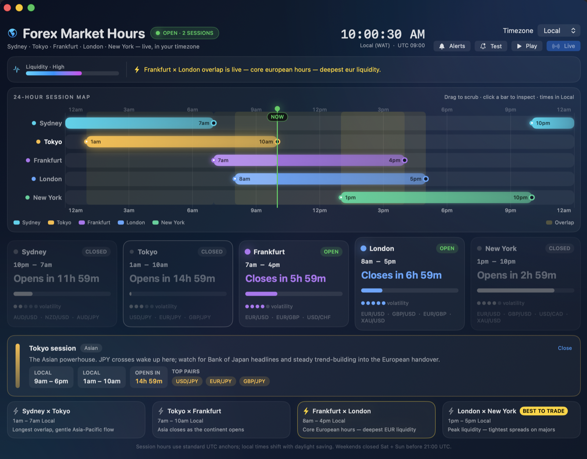

# Forex Market Hours

A beautiful, interactive macOS visualizer for forex trading sessions — inspired by the
[Babypips Forex Market Hours](https://www.babypips.com/tools/forex-market-hours) tool.
100% offline: all hours are computed locally, no network calls, no tracking.



## Features

- **24-hour session map** — Sydney, Tokyo, Frankfurt, London and New York lanes with
  overlap bands, live NOW marker, and true open/close times pinned to every bar
- **Scrub & play** — drag the timeline to preview any hour, or press Play to animate
  the market forward (15 market-minutes per second)
- **Timezone converter** — Local, UTC, Sydney, Tokyo, Frankfurt, London, New York
  (DST-aware)
- **Session cards** — live countdowns, progress, volatility meter, top pairs
  (incl. **XAU/USD** gold on London/New York); closed sessions grey out
- **Alerts** — distinct bells plus time-sensitive macOS banner popups on every
  session open/close, in live and play modes
- **Liquidity gauge, overlap strip** (incl. "Best to trade" London × New York),
  weekend-closed state

## Install

Download `ForexMarketHours-<version>-macOS.dmg` from the
[Releases](https://github.com/Marvelxy/ForexMarketHours/releases) page,
open it and drag **Forex Market Hours** into **Applications**.
Runs on Apple Silicon and Intel (universal binary), macOS 14+.

> Unsigned developer build: on first launch, right-click the app → Open
> (or allow it in System Settings → Privacy & Security).

## Build from source

Requires Xcode 16+ (Swift 6) on macOS.

```bash
make run-native   # fast dev loop: build for your Mac and launch
make app          # universal (arm64 + x86_64) .app bundle in ./build
make dmg          # drag-to-install DMG in ./dist  (VERSION=1.2.3 to tag it)
make install      # copy the bundle into /Applications
```

## Project layout

```
Package.swift                  # SwiftPM executable, macOS 14+
Sources/ForexMarketHours/
  ForexMarketHoursApp.swift    # @main app + window
  MarketData.swift             # sessions, overlaps, UTC math, liquidity
  ContentView.swift            # timeline, cards, alerts, notifications
Scripts/
  build-app.sh                 # universal .app bundler + ad-hoc sign
  make-dmg.sh                  # drag-to-install DMG builder
  make-icon.swift              # generates AppIcon.icns (CoreGraphics, no assets needed)
Resources/Info.plist
.github/workflows/            # CI build + tagged-release DMG pipeline
```

Session hours follow the Babypips convention (UTC anchors; local times shift
with daylight saving). Weekends closed: all Saturday + Sunday before 21:00 UTC.

## License

Copyright (C) 2026 Marvelxy — GNU General Public License v3.0 or later.
See [LICENSE](LICENSE). The DMG ships with a copy of the license.
